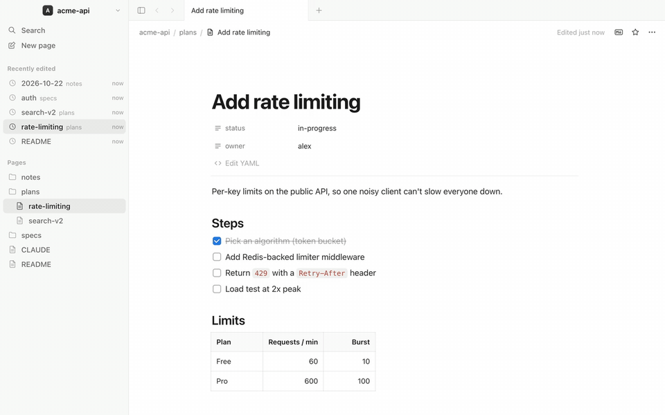

# Motion

A Notion-like Markdown editor for macOS run fully local.



## Why

More and more working docs (plans, specs, notes, CLAUDE.md) are Markdown files in a git repo, written together with AI coding agents. The tools for reading and editing them make you choose: Notion has the best editing feel but keeps your docs in its own database, while VS Code and Obsidian work on the real files but feel like editing source.

Motion is both: Notion's block editing on top of plain `.md` files, with the files staying the source of truth.

Two things set it apart from other Markdown editors:

- **Blocks, not WYSIWYG.** Slash menu, drag handles and block selection, the way Notion works, rather than a styled text area.
- **Built for editing alongside an agent.** Untouched text is never rewritten, so diffs stay small, and edits made on disk while a file is open show up live without clobbering yours.

## What it does

- **Blocks on files.** Open a folder and every `.md` becomes a page with Notion's block UX: `/` menu, drag handles, toggles, callouts, to-dos, tables, Mermaid, multi-block select and move, tabs, ⌘P search.
- **Real Markdown out.** Every block maps to standard GFM (callouts → `> [!NOTE]`, toggles → `<details>`, properties → YAML frontmatter). Anything Motion doesn't understand is kept verbatim.
- **Clean diffs.** Blocks you didn't touch are written back byte-for-byte, so a one-word edit is a one-line git diff, and opening a file never rewrites it.
- **Safe co-editing with agents.** Changes from Claude Code, git or anything else show up live. Saves are compare-and-swap, so a conflicting edit pauses autosave and asks you which version to keep; nothing is overwritten silently.
- **The rest of the repo.** `.sql`, `.json`, `.txt`, `.csv` and `.mdx` files open in a code view. Recently edited lists files changed anywhere in the folder, and a dot marks pages edited outside Motion.

## How it works

Electron + React + TipTap (ProseMirror). A custom markdown-it parser records each block's source range; the serializer reuses that exact source for unchanged blocks and only regenerates the edited ones. A file watcher in the main process indexes the folder (titles, links, search text) and pushes outside edits to open pages. Files that wouldn't round-trip exactly open in raw source mode instead of blocks.

## What's next

- **Review agent edits.** What changed on disk since you last looked, and who changed it (you, an agent, git).
- **Read mode.** Open docs read-only so reviewing an agent's plan can't change it.
- **Database view from frontmatter.** A simple filterable table or list of the pages in a folder.
- **Stay local-first.** No account, no network, works offline. Sync is git's job.

## Run it

```sh
npm install
npm run dev          # hot-reloading dev build (first run downloads Electron, ~100 MB)
npm run package      # → release/mac-arm64/Motion.app (ad-hoc signed)
```

Open things from the terminal (or from Claude Code):

```sh
open -a Motion path/to/plan.md      # file: opens it, rooted at its git repo
open -a Motion ~/Developer/claudepm # folder: opens it as the workspace
bin/motion path/to/plan.md          # same, and creates the file if it doesn't exist
```

## How it maps to markdown

| Notion block | Markdown on disk |
| --- | --- |
| Page title | First `# H1` (or the filename when there isn't one) |
| Properties | YAML frontmatter (`---json` frontmatter is shown read-mostly) |
| Text, H1–H3, bulleted/numbered/to-do lists, quote, divider, code | Standard GFM |
| Callout | GitHub alert: `> [!NOTE]`, `[!TIP]`, `[!IMPORTANT]`, `[!WARNING]`, `[!CAUTION]` |
| Toggle list | `<details><summary>…</summary> … </details>` |
| Table | GFM pipe table (with column alignment) |
| Page link | Relative link `[Title](other.md)`; `[[wikilinks]]` resolve by filename |
| Mermaid | ` ```mermaid ` code block, rendered as a diagram |
| Anything else (HTML blocks, reference definitions, …) | Kept verbatim as a raw block |

Every `.md` in the test corpus round-trips unchanged (`npm test`).

## Keyboard

| | |
| --- | --- |
| `/` | Block menu (type to filter) |
| `@` / `[[` | Link to another page / insert a wikilink |
| `#`, `##`, `###`, `-`, `1.`, `[]`, `>`, `"`, `>>`, ` ``` `, `---` + space | Markdown shortcuts |
| `Esc` | Select the current block; then `↑`/`↓`, `Delete`, `⌘C`, `⌘D` |
| `⌘D` | Duplicate block |
| `⌘⇧↑` / `⌘⇧↓` | Move block up / down |
| `⌘⌥0`–`⌘⌥8` | Turn into text, H1–H3, to-do, bullet, numbered, toggle, code |
| `⌘↵` | Check a to-do / open a toggle |
| `⌘K` | Link (paste a URL or search pages) |
| `⌘B` `⌘I` `⌘⇧S` `⌘E` | Bold, italic, strikethrough, inline code |
| `⌘P` | Search pages and text |
| `⌘N` | New page (named from its title once you leave the title) |
| `⌘F` | Find in page |
| `⌘/` | Toggle raw markdown source |
| `⌘\` | Toggle sidebar |
| `⌘[` / `⌘]` | Back / forward |

Hover any block for the `+` and `⋮⋮` handles: drag to reorder, click for Turn into / Duplicate / Move / Copy as Markdown / Delete.

## Tests

```sh
npm test       # markdown round-trip over tests/fixtures (MD_ROOT=path to use another folder)
npm run e2e    # drives the built app with Playwright against a throwaway folder
```

## Layout

- `src/main` — Electron main: workspace index + file watcher (`workspace.ts`), IPC, menus
- `src/renderer/src/editor/markdown` — markdown ↔ ProseMirror (`parse.ts`, `serialize.ts`)
- `src/renderer/src/editor` — TipTap schema, Notion behaviors (keys, slash menu, drag handle, toolbar, tables, outline)
- `src/renderer/src/components` — sidebar, top bar, page view (load/save/reload), search, properties

## License

[MIT](LICENSE)
