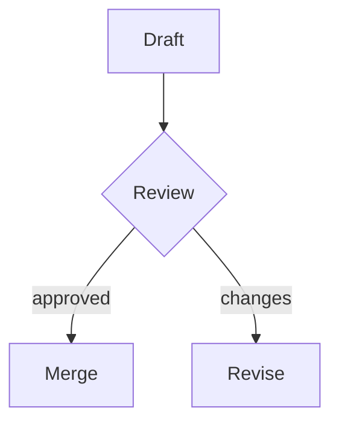

# Kitchen sink

A paragraph with **bold**, *italic*, ~~strike~~, `inline code`, and a [link](https://example.com). Also a wiki link to [[style-guide]].

## Lists

- First bullet
- Second bullet
  - Nested bullet
    - Deeper
- Third

1. One
2. Two
3. Three

- [ ] Open task
- [x] Done task

> A quote from a customer about the new editor.

> [!NOTE]
> This is a callout rendered from a GitHub alert.

> [!WARNING]
> Careful with very large files.

<details>
<summary>Toggle me</summary>

Hidden content inside the toggle.

</details>

---

```sql
SELECT
    project_id,
    COUNT(*) AS rows
FROM tasks
GROUP BY 1
```

| Project | Status | Budget |
| :--- | :---: | ---: |
| Acme | Live | $1.2M |
| Globex | At risk | $800K |


